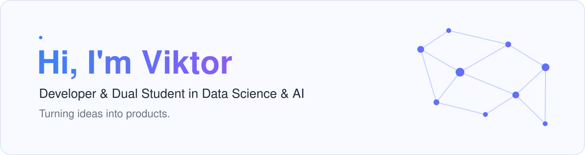
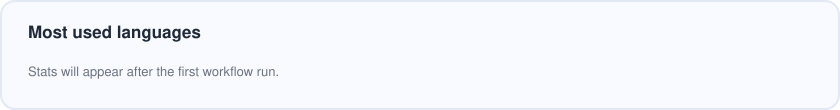

<picture>
  <source media="(prefers-color-scheme: dark)" srcset="assets/banner-dark.svg">
  
</picture>

  <a href="https://www.linkedin.com/in/viktor-holst-627383326">
    <picture>
      <source media="(prefers-color-scheme: dark)" srcset="assets/linkedin-dark.svg">
      
    </picture>
  </a>

### About me

&nbsp; Dual student in **Data Science & AI** – learning the theory, applying it at work 
&nbsp; Building **mobile apps with React Native**, from first idea to release 
&nbsp; Turning **startup ideas** into MVPs to see what sticks 
&nbsp; Currently exploring **robotics** and new corners of app development 
&nbsp; Ask me about turning a late-night idea into a working prototype

### Tech stack

**Data & AI** 

**Apps & Web** 

**Databases & Tools** 

<!-- GitHub stats: hidden until there are public repos. Remove this comment wrapper to show the card again.
### GitHub stats

<picture>
  <source media="(prefers-color-scheme: dark)" srcset="assets/top-languages-dark.svg">
  
</picture>
-->
